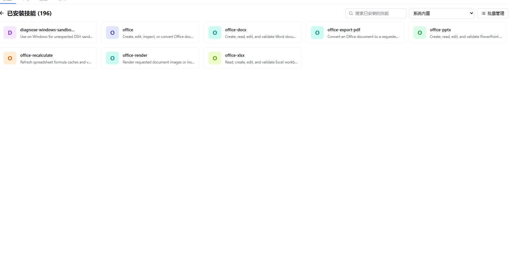
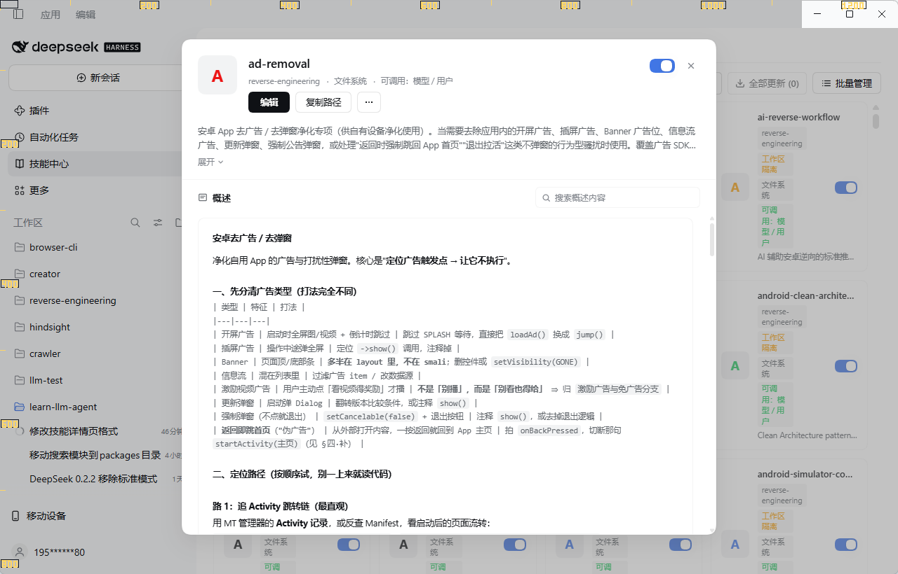
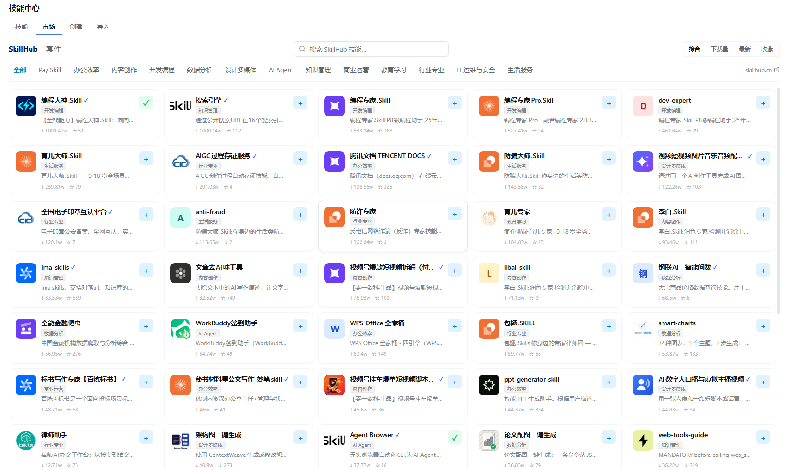

# dsh-skill-manager ·  Skill  Manager for DeepSeek Harness (DSH)

[中文](README.md) | English

<p align="center">
  
  &nbsp;
  
  &nbsp;
  
</p>

<p align="center">
  <strong>Visual Skill & Tool Explorer for DeepSeek Harness (DSH) Web GUI & Desktop</strong><br>
  <em>Tiered Skill Catalog · Model Invocation Toggle · Skill Marketplace & Git Installation · Update Checks · Visual SKILL.md Editor · Safe Trash & Git Backup · Zero Intrusion</em>
</p>

A visual Skill Explorer for DeepSeek Harness (DSH) Web GUI and desktop client: browse loaded skills tiered by source origin, toggle model invocation permissions, install from SkillHub Plaza and from Git repositories into the skills-manager central store, check upstream revisions and update in place, manage presets and batch operations, author and edit skills in place, safely delete through a recoverable trash mechanism, and back the skill library up to a git repository.

## Screenshots

### Skills list



Skills grouped by source, with a search box, source filter and batch management entry at the top.

### Skill detail modal



Clicking a skill card opens a centered detail card: icon, name and source facts on top with the enable switch and close on the right; the primary Edit action, the Copy Path action and a More menu; an expandable description; and an overview search that filters the body line by line and highlights hits.

### SkillHub Plaza



Category pills, score/downloads/latest/stars sorting, and a quick install button on each card.

## What it does

- **Sidebar row** "Skill Center" (in the shell's panel list, beside Plugins, Schedule and the task board) opens a native center-column page with a tab bar. The row opens the panel, and opening any session or new chat returns the center column to the conversation, matching the shell's own Plugins and Schedule pages; the page carries no back control of its own.
- **Skills tab**: skills grouped by source (system bundled / project `.dsh/skills` / project `.agents/skills` / custom directories / skills-manager central store / user `~/.dsh/skills` / user `~/.agents/skills` / runtime registered). The top search box filters by name or description as you type (name hits prioritized, Escape clears), stacking with workspace selection. Toolbar provides "Check All" and "Update All (N)" buttons. Skill rows and the detail modal display update badges (Update Available / Up to date / Check Failed) and quick update buttons. Each row displays description, when-to-use, invocation marks, an enable/disable switch (rewrites `disable-model-invocation` in SKILL.md frontmatter with hot catalog refresh; plugin-provided files record switches in the panel's own store), a copy-path action, a duplicate-as-template entry, an edit action, pin/unpin toggles, and a delete button (moves the whole skill directory into `.trash` under the skill's own name, recoverable; a skill the central store manages also loses its database row and deployed copies).
- **Skill Detail Modal**: clicking a skill card opens a centered detail card with a large icon, the skill name and a fact line (workspace, provider, symlink, invocation marks, update availability), followed by the enable/disable switch and the close button, then the primary action (Edit), a secondary action (Copy Path) and a More menu (Duplicate as template, Check for updates, Update this skill, Delete). The Overview section shows an expandable description and when-to-use, with a search box that filters the body line by line and highlights hits; the body renders headings, lists, fenced code and tables (read-only preview, not full Markdown).
- **Presets and batch management**: a preset is a named set of skills; activating it deploys the members into the four chosen harness roots (user/project x `~/.dsh`/`~/.agents`) and takes back the copies a previous preset deployed. Ownership is recorded, not inferred: only a target that still matches its deployment record is removed or replaced, and a directory someone else created is refused and reported. Switch, apply or delete presets at any time; batch mode selects multiple skills and moves them to trash with one click, reporting each success and failure.
- **Backup tab**: treats the central library (`~/.agents/skills-manager/skills`) as a plain git repository: create it, commit with a snapshot tag, configure a remote and push, and restore a snapshot (committing the current state as a safety snapshot first, so the restore itself is undoable). When both sides moved it reports `diverged` and never merges automatically, because a three-way merge across skill trees can silently lose one side.
- **Command palette**: `Ctrl+K` / `Cmd+K` searches skills, presets and actions (check all updates, update all).
- **Workspace awareness and isolation**: automatically detects active workspace; displays isolation indicators and hints when a project skill belongs to a non-active workspace; provides workspace filtering by all, current workspace, user skills, or system bundled.
- **Filters and source folding**: search stacks with three facets (source groups, enabled/disabled status, and row marks: provided by plugin / no local file / symlinked) behind a toolbar toggle showing an active facet badge. Group headers fold/unfold rows (defaulting to project and user roots on first use); fold states and facet filters persist in browser `localStorage`, while presets live in the central library database.
- **Market tab (Integrated SkillHub Plaza & Git Repository Installation)**: discover and install AI skills from the community across two sub-views:
  - **SkillHub Plaza**: 4 sorting modes (Score, Downloads, Latest, Stars); horizontally scrolling pills across 14 categories (Dev, Office, Content, Agent, etc.); responsive 5-column grid with cards showing icons, badges, summaries, metrics, and quick '+' install buttons; click card to open TRACE evaluation drawer with Markdown instructions, TRACE 5-dimension radar report (Trust, Reliability, Adaptability, Convention, Effectiveness), and version history; installs to user (`~/.agents/skills`) or project workspaces.
  - **Git Repository Installation**: install skills from any public or private Git repository (SSH, HTTPS, local clone). Clones into an isolated temporary directory, recursively scans and discovers valid `SKILL.md` candidates, supports multi-selection, custom skill names, target root selection (user global `~/.agents/skills` or active project workspace), and synchronizes with the `~/.agents/skills-manager` central store database. An imported-repository list stays under the form, grouping the managed skills by normalized repository URL with skill count, latest install time, and update availability; the install preview warns before a same-named skill from another repository would be overwritten. Each upstream repository keeps one local checkout cache (`~/.agents/skills-manager/cache/repos/`); preview, install, and update all materialize their temporary checkout from it, so a repeat operation fetches a delta instead of re-downloading the whole repository. The cache is capped at 1 GB and evicts least-recently-used slots past that, and an unreachable remote is reported as an error rather than silently answered from stale cached content.
- **Create tab**: visual form to author new skills in user root (`~/.agents/skills`) or project root (`.dsh/skills`), generating standard SKILL.md files that take effect immediately without restart.
- **Edit tab**: opens from the skill list or the detail modal, reads instruction content safely through the host, and rewrites description, when-to-use, and body in place while preserving name, location, and enabled state.
- **Import tab**: batch-create skills from host directory or browser-read `.zip` archive. Candidates are validated against official rules and source rank; imports only create new files and never overwrite existing skills.
- Data comes from filesystem scans following official dsh-skill-filesystem root conventions, merged with `ctx.skills` registry (bundled and runtime entries). Scans read `customSkillDirs` from plugin config and live loader rows. The plugin is a pure GUI management layer without changing skill loading or injection semantics.
- Skills that write routes cannot serve are badged by actual local state: plugin providers reporting instruction files are badged **"Provided by plugin"** with toggle support; fileless runtime registrations are badged **"No local file"**. Both omit edit and delete buttons to avoid invalid operations.
- Only skills that official providers would load are listed: SKILL.md files must declare non-empty name and description matching official kebab-case grammar.
- Duplicate skill names resolve by official source rank (project `.dsh/skills` 100, project `.agents/skills` 200, runtime 250, custom 300, user `~/.dsh/skills` 400, user `~/.agents/skills` 500, bundled 600), ensuring the panel reflects model execution.

## Install

### From npm (recommended)

```sh
dsh plugin --profile web add @moruoxing/dsh-skill-manager@latest
```

### From the repository (development)

```sh
git clone https://github.com/ruoxhub/dsh-skill-manager.git
cd dsh-skill-manager
pnpm install
pnpm build
dsh plugin --profile web add link:$(pwd)
```

Restart `dsh web` after installing; the "Skill Center" entry appears in the sidebar.

## Routes

| Route | Method | Purpose |
| --- | --- | --- |
| `/api/dsh-skill-explorer/list` | GET | Grouped skill list and workspace info |
| `/api/dsh-skill-explorer/read` | GET | One skill's editable fields and body (`?name=&path=`) |
| `/api/dsh-skill-explorer/set-enabled` | POST | Enable/disable skill (rewrites frontmatter) |
| `/api/dsh-skill-explorer/set-provider-enabled` | POST | Enable/disable plugin-provided skill (recorded in panel store) |
| `/api/dsh-skill-explorer/create` | POST | Create a skill (user/project root) |
| `/api/dsh-skill-explorer/import` | POST | Batch-create skills from directory or .zip archive |
| `/api/dsh-skill-explorer/update` | POST | Edit an existing skill in place (name and location unchanged) |
| `/api/dsh-skill-explorer/delete` | POST | Delete skill (whole directory moved into .trash; central-store row and deployed copies cleaned up) |
| `/api/dsh-skill-explorer/check-all` | POST | Check upstream revisions for all central store skills |
| `/api/dsh-skill-explorer/check-one` | POST | Check upstream revision for a single skill |
| `/api/dsh-skill-explorer/update-all` | POST | Batch-update all skills with available updates |
| `/api/dsh-skill-explorer/update-one` | POST | Fetch and update a specific skill to the latest revision |
| `/api/dsh-skill-explorer/health` | GET | Health probe |
| `/api/dsh-skill-explorer/market/search` | GET | Search and query SkillHub marketplace |
| `/api/dsh-skill-explorer/market/detail` | GET | SkillHub skill details and TRACE evaluation |
| `/api/dsh-skill-explorer/market/install` | POST | Download and install skill from SkillHub |
| `/api/dsh-skill-explorer/git/preview` | POST | Shallow-clone Git repository and preview discovered skills |
| `/api/dsh-skill-explorer/git/confirm` | POST | Confirm and install selected skills to central store and target agent directory |
| `/api/dsh-skill-explorer/git/cancel` | POST | Cancel preview session and clean up temporary clone directory |
| `/api/dsh-skill-explorer/presets` | GET | Stored presets and deployment records |
| `/api/dsh-skill-explorer/presets/save` | POST | Create or update a preset |
| `/api/dsh-skill-explorer/presets/apply` | POST | Activate a preset (deploy members, reclaim the previous preset's copies) |
| `/api/dsh-skill-explorer/presets/delete` | POST | Delete a preset |
| `/api/dsh-skill-explorer/backup/status` | GET | Backup repository state and remote health |
| `/api/dsh-skill-explorer/backup/init` | POST | Create the library git repository |
| `/api/dsh-skill-explorer/backup/commit` | POST | Commit current state, optionally tag a snapshot and push |
| `/api/dsh-skill-explorer/backup/snapshots` | GET | List restorable snapshots |
| `/api/dsh-skill-explorer/backup/restore` | POST | Restore a snapshot (commits a safety snapshot first) |
| `/api/dsh-skill-explorer/backup/remote` | POST | Set the backup remote |
| `/api/dsh-skill-explorer/tags` | GET | Read tags per skill |
| `/api/dsh-skill-explorer/tags/set` | POST | Set a skill's tags |
| `/api/dsh-skill-explorer/tags/rename` | POST | Rename a tag |
| `/api/dsh-skill-explorer/tags/delete` | POST | Delete a tag |
| `/api/dsh-skill-explorer/trash` | GET | List trash entries |
| `/api/dsh-skill-explorer/trash/restore` | POST | Restore a skill from trash |
| `/api/dsh-skill-explorer/audit` | GET | Recent skill-library audit entries |

## Security model

- Every `/api/dsh-skill-explorer/*` route is loopback-only by default (shared plugin-family fence: loopback socket + Host header + browser same-origin markers): unpaired LAN clients receive `403 forbidden: loopback-only` before any skill-file access. When `dsh-remote-web-ui` is also loaded, a valid paired-device cookie serves as an additional allow path; unpaired and revoked devices stay 403. The skill center does not depend on the remote plugin.
- Write routes accept panel-displayed paths only as an identity claim; before mutating, a fresh filesystem scan must resolve the same skill name and exact path. Arbitrary paths and stale same-name fallbacks are rejected to prevent mismatched operations.
- The read route applies identical security checks: installed skills must match fresh scan paths, while marketplace skill previews strictly verify that the canonical path resides within authorized `agentsHome` or `dshHome` directories, preventing arbitrary file reads.
- The update route rewrites existing SKILL.md files in place without altering skill name or location, preserving `disable-model-invocation` so edits cannot silently re-enable disabled skills. Symlinked skills are refused here for the same reason deletion is.
- The plugin-provided switch route stores one `(provider, skill name)` record in `$DSH_HOME/dsh-skill-explorer/provider-toggles.json` (atomic temp file + fsync + rename; corrupt documents degrade safely). The client sends identities rather than file paths, and both enable and disable actions are idempotent.
- The import route enforces strict read and write boundaries: host directories are scanned one level for `<name>/SKILL.md` or `<name>.md`, skipping symlinks and dot entries; uploaded archives are read by the browser and submitted; writes strictly create new files under user or project skill roots without overwriting existing files; requests are bounded (archive 4MB, entries 512, one SKILL.md 64KB, 4MB expanded text); malformed or escaping archives (zip64, encrypted entries, Zip Slip paths) answer 400 with the offending entry.
- Skill content is user-authored Markdown; create, edit, and import routes enforce a 64KB size limit.
- The panel renders skill descriptions and text using text nodes only (no HTML injection).
- Scans follow symlinks: symlinked skill directories and single-file `.md` links in skill roots are listed normally. To prevent target displacement and skill root escape, **symlinked skills cannot be deleted or edited in place** (buttons hidden in panel, 400 returned on delete/update routes); enable/disable toggles function normally by rewriting the target frontmatter.

## Known limitations

- Project skills follow the workspace selected in the panel: the list route supports explicit `?cwd=` overrides, and create/install operations target the active workspace; the project root resolves to the nearest `.git` ancestor. Write routes resolve the same workspace, keeping skills manageable even when host cwd differs.
- The workspace inventory follows the DSH workspace registry: deleting a workspace removes only its registration and keeps its folder and session logs (those sessions move under "Ungrouped"), so a deleted workspace's retained session `cwd` is never re-listed as a workspace. Only a host without a registry service (a headless run, an older harness) falls back to inferring workspaces from active session cwds.
- Frontmatter parsing is a lightweight zero-dependency implementation (block scalars, booleans, nested input blocks); unsupported exotic YAML syntax falls back to the official dsh-skill-filesystem provider.
- Coverage includes scanned filesystem roots and the global layer of `ctx.skills` registry. Directories in host-plane `skill-filesystem` rows are scanned; skills scoped solely to a specific agent preset require the preset catalog.
- The switch on "Provided by plugin" rows is a panel-local view state: it modifies what the panel displays as invokable while the host registry still loads the skill. Complete removal requires adjusting or removing the upstream plugin.
- Symlinked skills cannot be deleted or edited in place (see security model); enable/disable toggles operate normally; single-file links are replaced by regular files during atomic rewrites while leaving target files untouched.
- Directory import reads one level and does not recurse; `.zip` import accepts `SKILL.md` at any depth, but non-Markdown auxiliary assets inside archives are ignored.
- Importing a duplicate skill already resolving at the same or stronger source rank is skipped (`exists` or `shadowed`) rather than overwritten. Candidates must be renamed first.
- Group fold preferences and facet filter selections persist in browser `localStorage` per profile across page reloads, but do not sync across browsers or incognito sessions; skill presets live in the central library database, so they do.

## Telemetry

The browser half sends one anonymous install heartbeat per UTC day to dsh-market.com: a random localStorage id plus this package's name, nothing else. The server stores only a salted hash of that id, never IP addresses, and exposes aggregate counts only. See [docs/telemetry.md](../../docs/telemetry.md) for the full contract.

## License

MIT.
