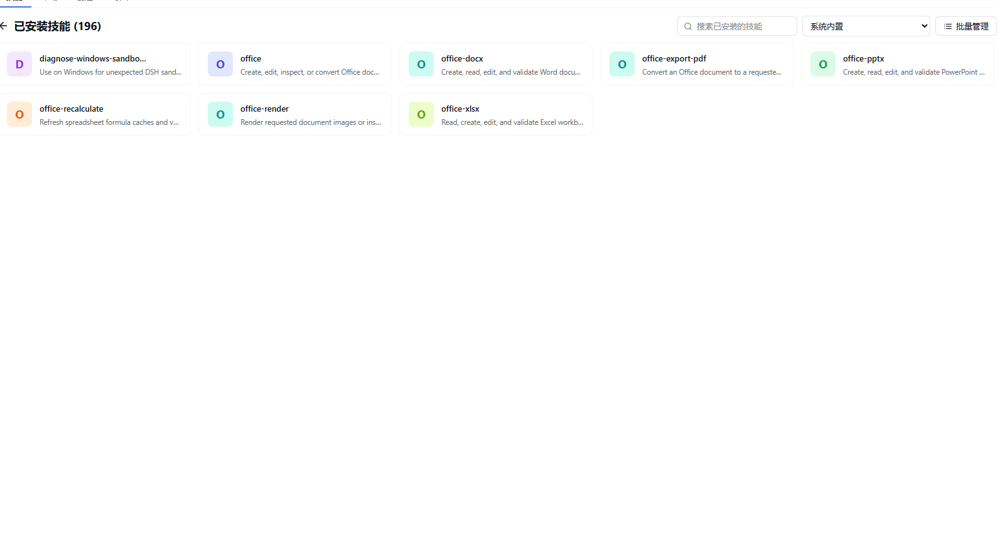
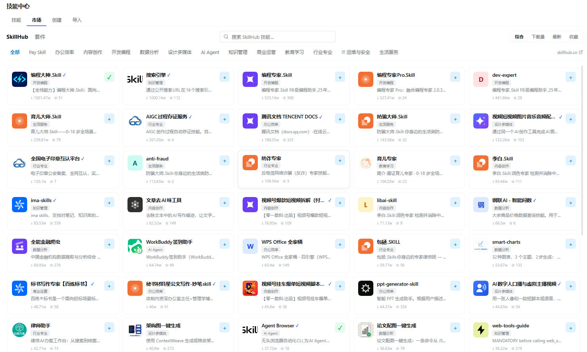
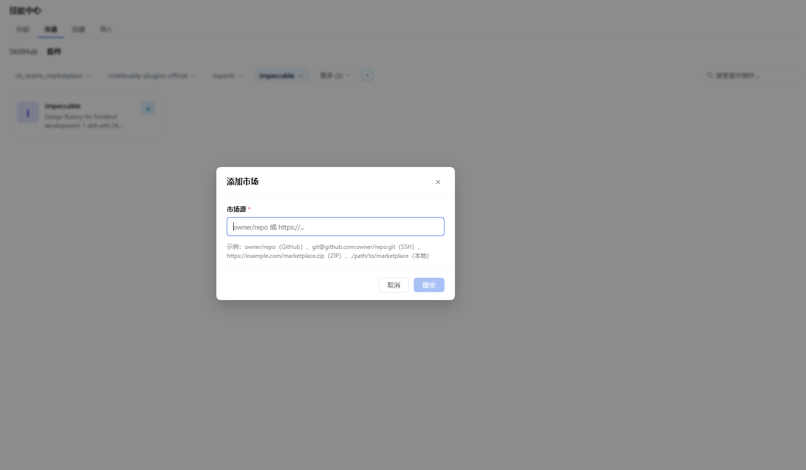

# dsh-skill-manager · DeepSeek Harness (DSH) Skill 技能管理

中文 | [English](README.en.md)

<p align="center">
  
  &nbsp;
  
  &nbsp;
  
</p>

<p align="center">
  <strong>DeepSeek Harness（DSH）官方 Web GUI 与桌面客户端专属技能中心与 Skill 管理面板</strong><br>
  <em>按来源层级浏览 · 一键启闭模型调用 · 技能广场与套件生态 · 可视化新建/编辑 SKILL.md · 安全回收站 · 零侵入管理</em>
</p>

DSH Web GUI 与官方桌面客户端的**技能中心**：按来源分级浏览已加载的全部 skill，启用/禁用模型调用，集成 SkillHub 广场与套件生态市场安装，支持技能预设与批量管理，创建与原地编辑技能，安全删除（移入可恢复的回收站）。

## 界面预览

### 技能列表



按来源分级展示技能，顶部提供搜索框、来源筛选与批量管理入口。

### SkillHub 技能广场



分类胶囊标签、综合/下载量/最新/收藏四种排序，卡片右侧提供快捷一键安装按钮。

### 套件生态市场



添加市场源时支持 GitHub 仓库、Git URL、ZIP 压缩包与本地目录四种形式。

## 功能

- 侧边栏「技能中心」入口（位于 shell 自身的面板列表，与插件、定时、任务看板并列）打开原生中栏页面，带页签栏。该入口负责打开面板，打开任意会话或新建对话即让中栏回到会话正文，与官方插件页、定时任务页行为一致；页面自身不设返回会话控件。
- **技能 tab**：按来源分级展示（系统内置、项目 `.dsh/skills`、项目 `.agents/skills`、自定义目录、用户 `~/.dsh/skills`、用户 `~/.agents/skills`、运行时注册）。顶部搜索框按技能名或描述即时过滤（名称命中优先，Esc 清空），支持与工作区选择叠加。每行显示描述、适用场景、调用支持标记、启用/禁用开关（改写 SKILL.md frontmatter 的 `disable-model-invocation`，模型目录热刷新；插件提供的文件开关由面板本地存储持久化）、复制为模板入口、编辑入口、固定/取消固定操作以及删除按钮（文件安全移入 `.trash`，可恢复）。
- **技能详情抽屉（Detail Drawer）**：点击技能项可滑出原生详情抽屉，展示技能名称、描述、适用场景、所属工作区、文件系统路径、调用支持状态，并提供完整 SKILL.md Markdown 指令正文在线预览与快速编辑、复制为模板入口。
- **预设管理与批量操作**：支持将当前已启用的技能组合保存为命名预设（Skill Presets），支持随时切换、一键应用或删除；支持进入批量管理模式，勾选多个技能一键批量移入回收站。
- **工作区感知与隔离标记**：自动识别会话当前工作区；当项目技能属于非当前会话工作区时，清晰展示工作区隔离标记与提示；工具栏支持按全部工作区、当前工作区、用户全局技能、系统内置技能进行精准筛选。
- **筛选与来源折叠**：搜索框与三个筛选维度叠加（要显示的来源分组、启用/禁用状态、行的标记：由插件提供/无本地文件/软链接），由工具栏统一展开，展示当前收窄维度的计数徽章。每个来源分组支持折叠与展开，首次使用时默认仅展开项目与用户根；折叠决定、筛选维度与预设配置均持久化在浏览器 `localStorage` 中。
- **市场 tab（集成 SkillHub 技能广场与套件生态）**：在技能中心无缝浏览、检索与安装优质 AI 技能，支持两种视界：
  - **SkillHub 技能广场**：提供综合评分、下载量、最新发布、收藏量 4 种排序模式；横向滚动 14 大分类胶囊标签（开发编程、办公提效、内容创作、AI Agent 等）；5 列响应式卡片展示图标、名称、官方认证徽章、简介、热度指标与快捷一键安装按钮；点击卡片滑出 TRACE 评测详情抽屉，展示完整 Markdown 说明、TRACE 五维质量得分（可信度、可靠性、适用性、规范性、有效性）雷达分项及版本记录；支持安装到全局用户目录（`~/.dsh/skills`）或当前项目工作区。
  - **套件生态市场（Suites）**：支持管理多个外部套件市场源（GitHub 仓库、Git URL、ZIP 压缩包或本地目录），支持添加市场源、一键同步刷新与安全移除；浏览套件源包含的工具插件，展示作者、许可证、分类、版本与包含技能列表；提供套件插件详情视图，完整展示插件包含的 Skills、Commands 与 MCP Servers 配置，支持点击技能查看正文，并支持一键整套安装。
- **创建 tab**：表单可视化新建技能，可选择写入用户全局根（`~/.dsh/skills`）或当前项目根（`.dsh/skills`），生成标准规范的 SKILL.md，即写即生效（无需重启）。
- **编辑 tab**：从技能列表或详情抽屉进入，经宿主安全读取技能内容，原地改写描述、适用场景与正文；技能名、文件路径与启用状态保持不变。
- **导入 tab**：从宿主机目录或浏览器读取的 `.zip` 压缩包批量导入技能。每个候选按官方规则严格校验，并按来源 rank 裁决同名冲突；导入仅新建文件，绝不覆盖已有技能。
- 数据来自按官方 dsh-skill-filesystem 根约定的文件系统扫描，并与 `ctx.skills` 注册表（内置与运行时条目）合并。扫描同时读取本插件配置的 `customSkillDirs` 以及各 loader 行上的同名配置。插件不改变 skill 的加载与注入语义，是纯 GUI 管理层。
- 写路由无法操作的技能按其实际本地形态打标：插件 provider 报告了真实指令文件的技能标记为**「由插件提供」**，支持本地启闭开关；无本地指令文件的运行时技能标记为**「无本地文件」**。两者均不提供编辑或删除按钮，避免无效调用。
- 只有官方 provider 会加载的技能才被列出：SKILL.md 必须声明非空名称与描述，且名称符合官方 kebab-case 文法。
- 同名技能严格按官方来源 rank 裁决（项目 `.dsh/skills` 100、项目 `.agents/skills` 200、运行时 250、自定义目录 300、用户 `~/.dsh/skills` 400、用户 `~/.agents/skills` 500、内置 600），确保面板展示与模型实际调用一致。

## 安装

### 从 npm（推荐）

```sh
dsh plugin --profile web add @moruoxing/dsh-skill-manager@latest
```

### 从仓库（开发）

```sh
git clone https://github.com/ruoxhub/dsh-skill-manager.git
cd dsh-skill-manager
pnpm install
pnpm build
dsh plugin --profile web add link:$(pwd)
```

安装后重启 `dsh web`，侧边栏出现「技能中心」入口。

## 路由

| 路由 | 方法 | 说明 |
| --- | --- | --- |
| `/api/dsh-skill-explorer/list` | GET | 分级技能列表与工作区信息 |
| `/api/dsh-skill-explorer/read` | GET | 单个技能的可编辑字段与正文（`?name=&path=`） |
| `/api/dsh-skill-explorer/set-enabled` | POST | 启用/禁用技能（改写 frontmatter） |
| `/api/dsh-skill-explorer/set-provider-enabled` | POST | 启用/禁用插件随附技能（记入面板专属存储） |
| `/api/dsh-skill-explorer/create` | POST | 创建技能（user/project 根） |
| `/api/dsh-skill-explorer/import` | POST | 从目录或 .zip 压缩包批量导入技能 |
| `/api/dsh-skill-explorer/update` | POST | 原地修改已有技能（名称与位置不变） |
| `/api/dsh-skill-explorer/delete` | POST | 删除技能（安全移入 .trash） |
| `/api/dsh-skill-explorer/health` | GET | 健康探测 |
| `/api/dsh-skill-explorer/market/search` | GET | 搜索与筛选 SkillHub 技能广场 |
| `/api/dsh-skill-explorer/market/detail` | GET | 获取 SkillHub 技能详情与 TRACE 评测数据 |
| `/api/dsh-skill-explorer/market/install` | POST | 下载并安装 SkillHub 技能到指定根目录或工作区 |
| `/api/dsh-skill-explorer/suites/marketplaces` | GET | 获取已配置的套件市场源列表 |
| `/api/dsh-skill-explorer/suites/marketplaces/add` | POST | 添加套件市场源（GitHub / Git / Zip / 本地目录） |
| `/api/dsh-skill-explorer/suites/marketplaces/remove` | POST | 移除指定套件市场源 |
| `/api/dsh-skill-explorer/suites/marketplaces/refresh` | POST | 刷新/同步套件市场源索引 |
| `/api/dsh-skill-explorer/suites/plugins` | GET | 查询套件市场源下的插件列表（支持搜索与安装状态检测） |
| `/api/dsh-skill-explorer/suites/plugin-detail` | GET | 获取套件插件完整详情（技能列表、命令、MCP 配置） |
| `/api/dsh-skill-explorer/suites/install` | POST | 安装套件插件中的技能到指定目标 |

## 安全模型

- 全部 `/api/dsh-skill-explorer/*` 路由默认仅限 loopback 访问（插件家族共享围栏：loopback 套接字 + Host 请求头 + 浏览器同源标记）：未配对的局域网客户端在任何技能文件访问前即收到 `403 forbidden: loopback-only`。当同时加载 `dsh-remote-web-ui` 时，有效的已配对设备 cookie 作为额外放行路径；未配对与已撤销设备保持 403。技能中心不硬依赖远程插件。
- 写路由仅将面板展示的路径作为身份声明；执行修改前，最新文件系统扫描必须解析到同名且路径完全一致的技能。任意未知路径与过期的同名回退均会被拒绝，防止项目技能变动引发误操作。
- read 路由采用相同的安全校验：已安装技能必须匹配最新扫描路径；对于套件生态市场技能预览，规范路径必须严格限制在 `agentsHome` 或 `dshHome` 目录内，严防越权任意文件读取。
- update 路由原地改写已有 SKILL.md，不更改技能名与存储路径，并原样保留当前的 `disable-model-invocation` 设置，防止编辑操作意外覆盖启用状态。与删除同理，软链接技能在该路由上直接拒绝。
- 插件技能开关路由将每条记录以 `(provider, 技能名)` 组合写入 `$DSH_HOME/dsh-skill-explorer/provider-toggles.json`（采用临时文件 + fsync + rename 原子落盘；损坏或异常文档安全降级）。客户端仅发送身份标识而不涉及文件路径；停用与启用操作均具备幂等性。
- 导入路由具有严格的读取与写入边界：宿主机目录仅扫描一层 `<名称>/SKILL.md` 或 `<名称>.md`，跳过符号链接与隐藏点目录；上传的压缩包由浏览器读取后提交；写入严格限制在用户或项目技能根目录下创建新文件，绝不覆盖已有文件；请求设有严格上限（压缩包 4MB、条目 512、单个 SKILL.md 64KB、展开文本 4MB）；异常或越界压缩包（zip64、加密条目、Zip Slip 路径穿越）一律 400 拒绝并返回详细原因。
- 技能内容限制为用户编写的 Markdown 格式；新建、编辑与导入路由均严格执行 64KB 大小上限。
- 面板渲染技能描述与文本时均采用纯文本节点，严禁 HTML 注入。
- 扫描支持符号链接：skill 根目录中的符号链接目录及单文件链接会被识别为普通技能并展示。但为了防止通过符号链接移出目录破坏原文件或造成路径逃逸，**软链接技能严格禁止删除和原地编辑**（界面隐藏相应操作按钮，并在 delete 与 update 路由上返回 400 拒绝）；软链接技能的启用/禁用操作正常可用（改写链接目标自身的 frontmatter）。

## 已知限制

- 项目技能遵循面板所选工作区：list 路由支持显式 `?cwd=` 覆盖，创建与安装操作均使用当前选定工作区；项目根目录解析为该工作区最近的 `.git` 祖先。写路由解析相同的工作区，确保进程工作目录位于其他路径时仍可正常管理。
- frontmatter 解析采用零依赖轻量实现（支持块标量、布尔值与嵌套输入块）；若包含不支持的复杂 YAML 高级语法，将以官方 dsh-skill-filesystem 提供方为准。
- 面板覆盖范围包含所扫描的文件系统根目录以及 `ctx.skills` 注册表的全局层。配置在 host 平面 `skill-filesystem` 上的 `customSkillDirs` 会被完整扫描；仅通过特定 agent preset 自身作用域生效的技能不在此全局覆盖范围内。
- 「由插件提供」技能的开关属于面板本地状态：它改变的是面板中呈现的可调用状态标记，宿主注册表仍会照常加载该技能。若需彻底移除此类技能，需在提供该技能的对应插件中进行配置或卸载。
- 软链接技能不可删除、不可编辑（详见安全模型）；启用/禁用功能对软链接技能有效；单文件软链接在原子改写时会被替换为普通独立文件，目标源文件保持不变。
- 本地目录导入仅扫描单层结构，不支持递归扫描嵌套目录；`.zip` 压缩包导入支持读取任意层级内的 `SKILL.md`，但包内的非 Markdown 附加资源文件会被忽略，不会一并复制。
- 导入同名技能时，若同级或更高优先级的来源已存在同名技能，将直接报告为跳过（`exists` 或 `shadowed`），避免覆盖。如需导入需先将技能重命名。
- 分组折叠状态、筛选维度偏好与技能预设均按浏览器环境保存在本地存储中，支持跨页面刷新与重新挂载，但不跨浏览器或无痕模式。

## 数据遥测

浏览器半区每个 UTC 日向 dsh-market.com 发送一次匿名安装心跳：仅含一个 localStorage 随机 ID 与本包名，无其他数据。服务端只存储该 ID 的加盐哈希，不存 IP，且只暴露聚合计数。完整契约见。

## 协议

MIT。
